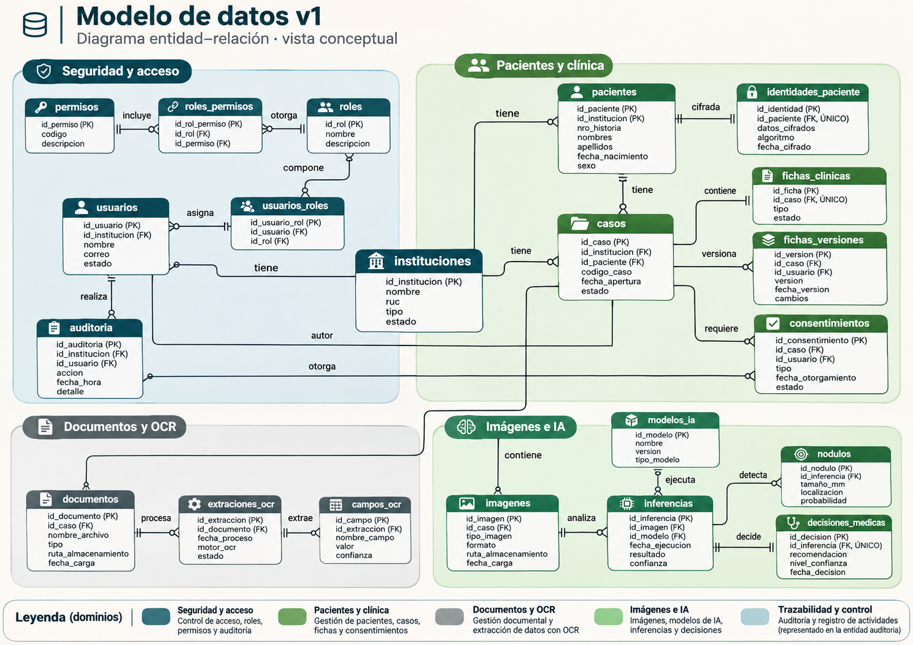
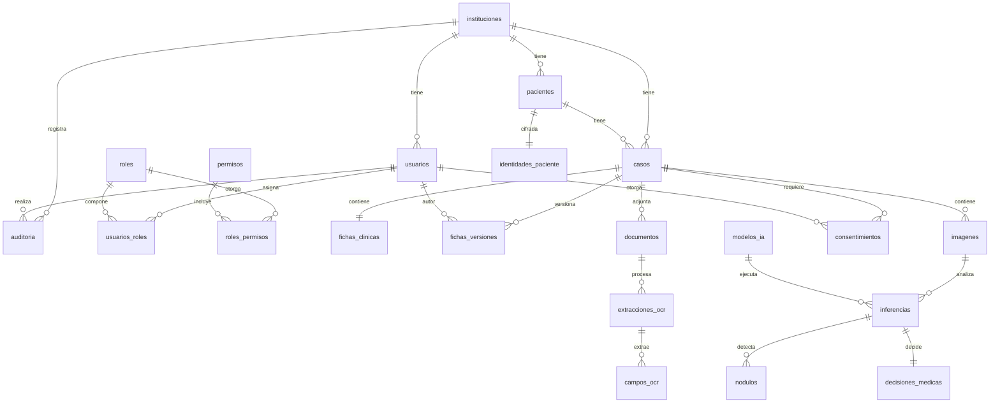

# Modelo de datos v1

## Diagrama

## Tablas

| Tabla | Propósito | Requisito |
|---|---|---|
| instituciones | Instituciones (pertenencia A12) | A12 |
| usuarios | Usuarios del sistema | RF-PAC-02 |
| roles | Roles (admin/doctor/researcher) | RF-PAC-02 |
| permisos | Permisos | RF-PAC-02 |
| usuarios_roles | Asignación usuario-rol | RF-PAC-02 |
| roles_permisos | Asignación rol-permiso | RF-PAC-02 |
| pacientes | Paciente seudonimizado (sin datos personales) | RF-PAC-02, A10 |
| identidades_paciente | Identidad cifrada aparte | RF-PAC-02, A10 |
| casos | Caso clínico | RF-PAC-01 |
| fichas_clinicas | Ficha con valores tipados y origen_datos | RF-CLI-05/06 |
| fichas_versiones | Historial con snapshot | RF-CLI-05 |
| documentos | Documentos con hash y versión (S3) | RF-DOC-03/04, A9 |
| extracciones_ocr | Extracción OCR con estado | RF-DOC-05/06/08 |
| campos_ocr | Campos OCR con confianza | RF-DOC-05/06/08 |
| imagenes | Imágenes sin metadatos EXIF/DICOM | RF-IMG-03 |
| modelos_ia | Modelos IA versionados | RF-INF-05/06/07 |
| inferencias | Inferencia inmutable | RF-INF-05/06/07, RIA-05/06 |
| nodulos | Hasta 3 nódulos por imagen | RF-INF-13/14 |
| decisiones_medicas | Decisión médica separada | RF-INF-09 |
| consentimientos | Consentimiento con base legal y vigencia | RF-PAC-06/07 |
| auditoria | Auditoría solo inserción | RF-AUD-08/09, A13 |

## Decisiones

- Identidad cifrada aparte: `pacientes` no contiene datos personales; `identidades_paciente` guarda solo criptogramas (`LargeBinary`).
- Auditoría insert-only: sin `actualizado_en`; PK `BigInteger` con `Identity`; nunca datos clínicos.
- Enums por CHECK: `String` + `CheckConstraint`, no `ENUM` nativo.
- PK UUID con `gen_random_uuid()`.
- Ficha: columnas tipadas para valores clínicos + `origen_datos` JSONB (campo → digitado/ocr_confirmado) + `fichas_versiones` con `snapshot` JSONB para historial.
- Documentos nunca sobrescritos: unique (caso_id, nombre_original, version).
- Nódulos: `indice` 1..3 con unique (inferencia_id, indice).
- Inferencia inmutable: sin `actualizado_en`; resultado en benigno/maligno/sin_nodulo.
- Sin nódulos no se clasifica (RF-INF-13/14): manejado en lógica; el esquema permite cero nódulos.
