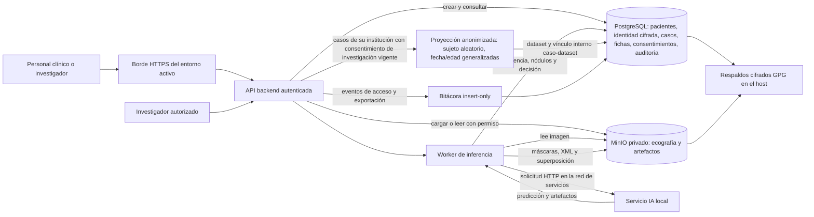

# TES-336 · HT-084 — Evaluación de impacto en protección de datos

**Estado:** evaluación técnica para revisión y aprobación institucional; no firmada.  
**Alcance:** sistema operativo OPTIMUS-THY y sus flujos de pacientes, casos clínicos, imágenes, inferencias y datasets de investigación. Se evalúa como tratamiento de datos de salud potencialmente identificables; este documento no incluye datos personales de pacientes.

Esta evaluación se basa en el diseño y la evidencia versionada del repositorio. No certifica la configuración efectiva de un servidor ni constituye asesoría legal o declaración de cumplimiento. La documentación operativa identifica más de un entorno y deja pendiente verificar en servidor la instalación nueva; la institución debe confirmar cuál está en uso y completar la aprobación antes de autorizar nuevos tratamientos de datos reales ([índice operativo](../operacion/README.md), [matriz de verificación](../operacion/matriz-verificacion.md)).

## 1. Descripción del tratamiento

OPTIMUS-THY permite registrar pacientes y casos de tiroides, conservar fichas clínicas, procesar ecografías mediante un servicio de inferencia local, registrar decisiones médicas y crear datasets anonimizados para investigación. El modelo de datos relaciona instituciones, usuarios y roles con pacientes, identidades, casos, fichas, imágenes, inferencias, consentimientos y auditoría ([modelo de datos](../arquitectura/modelo-de-datos-v1.md), [servicio de IA](../arquitectura/servicio-ia.md), [API de datasets](../../backend/app/api/datasets.py)).

| Categoría | Finalidad | Acceso previsto | Residencia según el repositorio |
| --- | --- | --- | --- |
| Identidad: nombres, apellidos, documento y fecha de nacimiento | Identificar al paciente y gestionar su caso; la identidad se consulta por una ruta específica | Personal con permiso activo `paciente.leer`; la consulta de identidad genera un evento `PII_REVEAL`. La autorización por rol no sustituye el acceso administrativo al host o a la base de datos | Tabla `identidades_paciente` en PostgreSQL, separada de `pacientes` y cifrada por campo ([modelo](../../backend/app/models/pacientes.py), [API de pacientes](../../backend/app/api/pacientes.py)) |
| Datos clínicos: código de caso, valores y fechas de TSH/T3/T4, unidades y categorías como TI-RADS/Bethesda | Atención y seguimiento clínico; son también atributos usados en la proyección para investigación | Médico con permisos clínicos; las consultas se limitan al ámbito institucional del usuario | Tablas PostgreSQL de casos, fichas y versiones ([modelo](../../backend/app/models/fichas.py), [permisos](../../backend/app/security/permisos.py)) |
| Ecografías, imágenes derivadas y artefactos de inferencia | Visualización y análisis de nódulos; conservar la entrada y resultados reproducibles | Médico autorizado; el backend emite enlaces firmados para descarga | Objetos en MinIO; PostgreSQL conserva referencias y metadatos. La IA recibe la imagen desde el worker por la red de servicios configurada en Compose ([almacenamiento](../arquitectura/almacenamiento.md), [flujo de IA](../arquitectura/servicio-ia.md), [compose](../../docker-compose.yml)) |
| Consentimientos | Registrar la base declarada, la versión del texto, el otorgamiento y su revocación | Personal con permisos de lectura/escritura del paciente; creación y revocación quedan auditadas | PostgreSQL, vinculados al caso ([modelo](../../backend/app/models/consentimientos.py), [API](../../backend/app/api/consentimientos.py)) |
| Datasets de investigación | Analizar casos bajo la finalidad de investigación configurada, sin publicar los identificadores directos | Rol investigador con permisos de investigación; la consulta del dataset queda dentro de la institución | Filas derivadas y vínculo interno con casos en PostgreSQL; el vínculo no se serializa en la respuesta ([modelo](../../backend/app/models/datasets.py), [API](../../backend/app/api/datasets.py)) |
| Auditoría y sesión | Trazar accesos, cambios, descargas, denegaciones y acciones administrativas | Administración autorizada y operadores con acceso a infraestructura; los eventos clínicos no se ofrecen a roles sin los permisos correspondientes | Tabla de auditoría en PostgreSQL; token de sesión y configuración de seguridad se gestionan en backend ([auditoría](../arquitectura/auditoria.md), [dependencias de autorización](../../backend/app/auth/deps.py)) |

Los roles de aplicación separan administración, atención clínica e investigación: `admin` no recibe permisos clínicos por defecto; `doctor` opera con pacientes, fichas, imágenes e inferencias; `researcher` trabaja con cohortes y exportación anonimizada. Un usuario multirrol actúa con el rol activo de su sesión y el cambio queda auditado ([matriz de permisos](../../backend/app/security/permisos.py), [ADR-013](../adr/ADR-013-multirol-rol-activo.md)). Las consultas de pacientes, casos y datasets filtran por institución y objeto en el servidor ([API de pacientes](../../backend/app/api/pacientes.py), [API de datasets](../../backend/app/api/datasets.py)).

Los datos persistentes de la aplicación se ubican en los volúmenes de PostgreSQL (`pgdata`) y MinIO (`miniodata`) del host que ejecute Docker Compose; la inferencia usa el servicio `ia` local. El runbook de `labturingserver` declara una exposición solo por Tailscale, pero indica que el host y la configuración efectiva están pendientes de verificación. El runbook de `tiroides2` describe una ruta por Cloudflare Tunnel. No se debe asumir que ambos entornos son equivalentes ni cuál contiene los datos actuales ([compose](../../docker-compose.yml), [índice operativo](../operacion/README.md), [runbooks](../operacion/labturingserver.md) y [tiroides2](../operacion/despliegue-tiroides2.md)).

## 2. Base de legitimación y consentimiento

El modelo limita `base_legal` a tres valores: `consentimiento`, `atencion_de_salud` e `investigacion_con_anonimizacion`. Registra caso, versión del texto, fecha de otorgamiento, actor que lo registra y fecha de revocación ([modelo de consentimiento](../../backend/app/models/consentimientos.py)). La API define `atencion_de_salud` como base que habilita la inferencia y, para construir datasets, selecciona casos con `investigacion_con_anonimizacion` vigente. La revocación se registra mediante una ruta y queda auditada ([API de consentimientos](../../backend/app/api/consentimientos.py), [selección de casos](../../backend/app/api/datasets.py)).

Estos valores son categorías implementadas por el sistema, no una determinación de que una base sea jurídicamente válida para cada propósito. El repositorio registra la versión del texto, pero el modelo no conserva el documento firmado ni un campo de firma; debe confirmarse cuál es la evidencia institucional del consentimiento y si el texto separa las finalidades necesarias. La elegibilidad de futuras generaciones de datasets excluye consentimientos revocados; no se debe inferir que ello borra automáticamente datasets ya generados. La institución y asesoría jurídica deben definir el efecto de una revocación sobre datasets existentes, copias y resultados derivados antes de aprobar el uso.

## 3. Categorías de datos y minimización

| Categoría | Tratamiento técnico | Minimización y límites conocidos |
| --- | --- | --- |
| Identificadores directos | Nombres, apellidos, documento y fecha de nacimiento se cifran en `identidades_paciente` con `EncryptedBytes` y AES-256-GCM. La tabla `pacientes` conserva seudónimo e institución, no esos campos ([modelo](../../backend/app/models/pacientes.py), [cifrado](../arquitectura/cifrado-en-reposo.md)) | La identidad se separa del caso, no se elimina. La ruta de identidad la devuelve a quien tenga `paciente.leer` y registra `PII_REVEAL` ([API de pacientes](../../backend/app/api/pacientes.py)). |
| Datos de salud | Fichas, versiones, casos y decisiones se conservan en PostgreSQL; no se documenta cifrado por columna para estos datos clínicos ([modelo de datos](../arquitectura/modelo-de-datos-v1.md)) | El control de acceso y el cifrado de identidad no equivalen a cifrado integral de la base. El cifrado del volumen depende del host y no está acreditado para todos los entornos ([cifrado en reposo](../arquitectura/cifrado-en-reposo.md)). |
| Ecografías y artefactos | MinIO privado aplica cifrado del lado del servidor `AES256`; las claves de objetos son UUID opacos y las descargas usan enlaces firmados ([almacenamiento](../arquitectura/almacenamiento.md), [adaptador S3](../../backend/app/storage/s3.py)) | Las imágenes se saneán de metadatos EXIF/ICC, pero el operativo no detecta texto incrustado. El modelo `Documento` conserva `nombre_original` en PostgreSQL; el uso de nombres con datos personales no queda prevenido por la clave opaca del objeto ([API de imágenes](../../backend/app/api/imagenes.py), [ADR-020](../adr/ADR-020-operativo-sin-ocr.md), [modelo de documentos](../../backend/app/models/documentos.py)). |
| Datos para investigación | Se omiten documento, fecha de nacimiento exacta y códigos de paciente/caso; se crea un sujeto aleatorio por dataset, las fechas se desplazan y reducen a mes y la edad se generaliza por decenios ([anonimización](../../backend/app/investigacion/anonimizacion.py)) | `datasets_casos` conserva `caso_id` para procedencia y para excluir retiros futuros, pero la API no lo serializa. El vínculo sigue siendo accesible dentro de la base y debe protegerse como dato seudonimizado, no tratarse como publicación anónima por sí solo ([modelo de datasets](../../backend/app/models/datasets.py)). |
| Auditoría | Guarda referencias de actor, institución, objeto, acción, hora, IP y agente de usuario; `detalles` admite claves/códigos controlados, no texto libre ni campos clínicos ([auditoría](../arquitectura/auditoria.md), [servicio](../../backend/app/audit/service.py)) | La bitácora minimiza el detalle clínico, pero conserva metadatos de acceso que también requieren control y plazo de conservación. |

El diseño evita guardar identificadores directos en la tabla ordinaria de pacientes, en las claves de objeto y en las filas publicables del dataset. No evita toda información identificable en el sistema: la identidad cifrada, el vínculo interno `dataset-caso`, la IP, el agente de usuario y el nombre original de algunos documentos sí pueden persistir. Las contraseñas se gestionan como hashes, no como texto claro ([seguridad de contraseñas](../../backend/app/security/passwords.py)).

## 4. Flujo de datos de extremo a extremo

El borde depende del entorno elegido: el runbook de `tiroides2` incluye Cloudflare Tunnel; el de `labturingserver` describe Tailscale, con configuración real aún por verificar. La cadena de IA local no incorpora OCR en el repositorio operativo ([índice operativo](../operacion/README.md), [servicio IA](../arquitectura/servicio-ia.md), [ADR-020](../adr/ADR-020-operativo-sin-ocr.md)).

## 5. Riesgos identificados

La probabilidad e impacto son cualitativos y preliminares; no son tasas calculadas a partir de incidentes. El riesgo residual debe reevaluarse con la institución que autorice el tratamiento.

| Riesgo | Probabilidad | Impacto | Medida existente y evidencia | Medida pendiente |
| --- | --- | --- | --- | --- |
| Reidentificación por combinación de edad, fechas, resultados poco frecuentes o fuentes externas | Media | Alto | El dataset omite identificadores, usa sujeto aleatorio, desplaza/trunca fechas, generaliza edad y exige tamaño mínimo `k ≥ 5` ([anonimización](../../backend/app/investigacion/anonimizacion.py), [API de datasets](../../backend/app/api/datasets.py), [modelo](../../backend/app/models/datasets.py)) | El código garantiza tamaño mínimo de cohorte, no demuestra que cada combinación de cuasi-identificadores tenga al menos cinco equivalentes. Medir equivalencias, celdas raras y riesgo de enlace; suprimir o generalizar combinaciones antes de cualquier entrega. |
| Acceso indebido a una identidad, caso o institución distinta | Baja-media | Alto | Permisos por rol activo, filtros por institución/objeto, respuesta no encontrada para recursos fuera del ámbito y auditoría de revelación de identidad ([dependencias](../../backend/app/auth/deps.py), [permisos](../../backend/app/security/permisos.py), [API de pacientes](../../backend/app/api/pacientes.py), [ADR-013](../adr/ADR-013-multirol-rol-activo.md)) | Revisar periódicamente altas, roles activos y permisos por institución; confirmar que la configuración de cada entorno mantiene las mismas restricciones y que las cuentas técnicas tienen mínimo privilegio. |
| Consentimiento o base declarada insuficiente; retiro no aplicado a copias ya creadas | Media | Alto | Base, versión y fechas registrables; ruta de revocación; la selección de datasets exige consentimiento de investigación vigente y registra la creación ([modelo](../../backend/app/models/consentimientos.py), [API de consentimientos](../../backend/app/api/consentimientos.py), [API de datasets](../../backend/app/api/datasets.py)) | Revisión legal e institucional del texto, finalidad y evidencia de firma; definir efecto del retiro sobre datasets existentes, respaldos y resultados derivados. |
| Divulgación de identidad por contenido de imagen, metadatos o nombre de archivo | Media | Alto | Bucket privado, cifrado AES256 en MinIO, claves de objeto opacas y saneamiento de EXIF/ICC ([almacenamiento](../arquitectura/almacenamiento.md), [API de imágenes](../../backend/app/api/imagenes.py), [modelo de documentos](../../backend/app/models/documentos.py)) | El operativo no detecta texto incrustado y el nombre original de documentos queda en la base. Definir validación/saneamiento de nombres y revisión de imágenes/documentos antes de compartir o investigar. |
| Exposición o pérdida de identidad por compromiso de clave o de volumen | Media | Alto | Identidad cifrada con AES-256-GCM y clave fuera del repositorio; archivos MinIO con cifrado del lado del servidor; respaldos cifrados con GPG ([cifrado](../arquitectura/cifrado-en-reposo.md), [S3](../../backend/app/storage/s3.py), [ADR-019](../adr/ADR-019-respaldos-cifrados.md)) | Acreditar cifrado del disco/volumen de PostgreSQL en el host, separación y custodia redundante de claves, rotación probada y restauración verificable. |
| Acceso de proveedor o transferencia fuera del perímetro institucional | Media, pendiente de confirmar | Alto | La IA opera como servicio local del Compose; las topologías documentadas difieren entre el borde por Cloudflare de `tiroides2` y el acceso por Tailscale previsto en `labturingserver` ([compose](../../docker-compose.yml), [índice de operación](../operacion/README.md)) | Confirmar el host y flujo efectivos; revisar proveedor, ubicación, condiciones de tratamiento y transferencia antes de usar el entorno correspondiente con datos reales. |
| Pérdida de datos o imposibilidad de restaurar | Media | Alto | ADR-019 define cifrado GPG, hashes y retención escalonada; el runbook documenta respaldos cifrados ([ADR-019](../adr/ADR-019-respaldos-cifrados.md), [custodia](../operacion/custodia-respaldos.md)) | La evidencia operativa del 9 de noviembre de 2026 registra una sola copia local de la clave, sin copia externa acreditada; la restauración de archivos MinIO en servidor sigue pendiente. Crear copias externas separadas y probar restauración completa en entorno aislado ([matriz de verificación](../operacion/matriz-verificacion.md)). |
| Error o sesgo de inferencia que influya indebidamente en una decisión clínica | Media | Alto | El resultado conserva versión/huella del modelo y la decisión médica es una entidad separada; si faltan pesos, la inferencia devuelve indisponibilidad en vez de resultado inventado ([servicio IA](../arquitectura/servicio-ia.md), [modelo de datos](../arquitectura/modelo-de-datos-v1.md)) | Documentar validación clínica, límites de uso, revisión humana y respuesta ante resultados discordantes; definir responsables de aprobación del modelo y cambios de pesos. |
| Conservación excesiva de casos, bitácoras o datasets vinculados | Media | Alto | ADR-019 establece una política de retención de respaldos, no una política completa de conservación de cada categoría de datos ([ADR-019](../adr/ADR-019-respaldos-cifrados.md), [modelo de datasets](../../backend/app/models/datasets.py)) | Aprobar plazos por categoría, borrado/anonimización al vencimiento y propagación a datasets, objetos y respaldos, con verificación institucional. |

## 6. Medidas técnicas verificables

- **Cifrado en reposo.** Las cuatro columnas de identidad usan AES-256-GCM mediante `EncryptedBytes`; la clave `PII_ENCRYPTION_KEY` no debe vivir en el repositorio. MinIO recibe `ServerSideEncryption="AES256"` al subir objetos. Los respaldos de PostgreSQL y MinIO se cifran con GPG/AES-256. Esto no acredita cifrado del volumen de PostgreSQL ni del disco de cada host ([`encryption.py`](../../backend/app/security/encryption.py), [`types.py`](../../backend/app/security/types.py), [`s3.py`](../../backend/app/storage/s3.py), [script de respaldo](../../infra/scripts/respaldo.sh), [cifrado en reposo](../arquitectura/cifrado-en-reposo.md)).
- **Control por objeto e institución.** Cada ruta requiere el permiso del rol activo; pacientes, consentimientos y datasets se consultan con filtros de institución y objeto en el backend. Cambiar el identificador no amplía el ámbito autorizado ([`deps.py`](../../backend/app/auth/deps.py), [`permisos.py`](../../backend/app/security/permisos.py), [`pacientes.py`](../../backend/app/api/pacientes.py), [`consentimientos.py`](../../backend/app/api/consentimientos.py), [`datasets.py`](../../backend/app/api/datasets.py)).
- **Bitácora.** Accesos a identidad, consentimientos, investigación, inferencias y cambios relevantes pueden registrarse con actor, rol, objeto, acción y hora; los detalles son códigos restringidos y la migración aplica solo inserción en PostgreSQL. La revisión de eventos está documentada en la [arquitectura de auditoría](../arquitectura/auditoria.md) y el [`AuditService`](../../backend/app/audit/service.py).
- **Anonimización y umbral `k ≥ 5`.** El endpoint rechaza un `k` inferior a cinco y una cohorte menor al valor solicitado; el modelo también impone `k >= 5` y `total_casos >= k`. La proyección omite identificadores directos, generaliza edad, desplaza fechas y crea un sujeto aleatorio por dataset ([`datasets.py`](../../backend/app/api/datasets.py), [`models/datasets.py`](../../backend/app/models/datasets.py), [`anonimizacion.py`](../../backend/app/investigacion/anonimizacion.py)). **Alcance verificable:** el repositorio impone el mínimo de tamaño y aplica desidentificación; no demuestra por sí solo k-anonimato formal para cada clase de equivalencia ni anonimización irreversible.
- **Límites de acceso y carga.** La matriz restringe acciones por rol; la API aplica límites configurables por minuto y un cupo más estricto para inferencia, además de topes de tamaño para archivos. El limitador es por proceso: no sustituye controles del borde ni mitiga por sí solo un ataque volumétrico ([`permisos.py`](../../backend/app/security/permisos.py), [`limites.py`](../../backend/app/security/limites.py), [ADR-021](../adr/ADR-021-limites-y-cabeceras.md)).
- **Respaldo cifrado.** ADR-019 establece cifrado simétrico AES-256 mediante GPG, checksums SHA-256 y retención propuesta de 14 copias diarias, 8 semanales y 6 mensuales. El estado documentado no acredita la copia externa de la clave ni de los backups; la matriz deja pendiente la recuperación real en servidor ([ADR-019](../adr/ADR-019-respaldos-cifrados.md), [`respaldo.sh`](../../infra/scripts/respaldo.sh), [custodia](../operacion/custodia-respaldos.md), [matriz](../operacion/matriz-verificacion.md)).

## 7. Fuera de alcance y revisión legal o institucional pendiente

Este documento no resuelve ni presume:

- Quién es formalmente responsable y quién encargado del tratamiento, qué institución determina cada finalidad, ni si corresponde designar un delegado de protección de datos. El plan de incidentes registra que estas figuras no están formalizadas en el repositorio ([plan de respuesta](plan-respuesta-incidentes.md)).
- Si las tres bases codificadas son adecuadas para cada operación, si el texto y la forma de consentimiento satisfacen los requisitos institucionales, qué información debe recibir el paciente ni cómo demostrar firma y versión aceptada.
- La aprobación ética y el convenio de intercambio de datos que correspondan a investigación con pacientes, ni quién autoriza su uso en cada institución. Debe confirmarse con la Dirección de tesis, asesoría jurídica y la institución de salud antes de habilitar el tratamiento real ([plan de respuesta](plan-respuesta-incidentes.md)).
- Plazos y mecanismos de acceso, rectificación, oposición, supresión, exportación o retiro; conservación de datos clínicos y reglas de eliminación de copias de seguridad.
- El rol contractual y la ubicación de datos/telemetría que pueda involucrar a Cloudflare u otros proveedores, así como las condiciones de transferencia aplicables a la topología que realmente se use ([operación](../operacion/README.md)).
- La validez clínica, sesgo, alcance de uso y responsabilidad por decisiones que utilicen inferencias de IA; tampoco se determina si el producto tiene una categoría regulatoria específica.
- La resistencia a reidentificación de un dataset concreto. El umbral de tamaño `k ≥ 5` no es una auditoría de equivalencia de atributos ni una autorización automática para liberar datos.

La aprobación legal e institucional debe definir estos puntos sin inferir cumplimiento normativo a partir de la existencia de controles técnicos.

## 8. Aprobación y revisión

**Firmas requeridas para cerrar esta evaluación:**

1. Representante autorizado de la institución que asuma formalmente el rol de responsable del tratamiento, y representante de la institución de salud cuando participe en la determinación o suministro de datos. La asignación debe quedar por escrito.
2. Dirección de tesis o responsable de investigación, que aprueba propósito, población, uso de los datasets y restricciones de publicación.
3. Responsable clínico designado, que valida el flujo asistencial, la revisión humana de inferencias y los límites de uso clínico.
4. Responsable técnico/seguridad, que verifica controles, configuración del entorno, accesos, claves, respaldos y cierre de riesgos técnicos.
5. Asesoría jurídica institucional y, si la institución lo designa, delegado de protección de datos. El plan de incidentes deja constancia de que el responsable/encargado y el delegado aún no están formalmente designados; hasta resolverlo, esta EIPD no puede darse por aprobada ([plan de respuesta](plan-respuesta-incidentes.md)).

La aprobación ética que la institución determine necesaria se tramita por su procedimiento propio; este documento no la reemplaza.

**Periodicidad propuesta:** revisión anual y, antes de habilitar el cambio, cuando se incorpore una nueva finalidad o categoría de datos, se modifique la inferencia o el proceso de anonimización, se cambie el host/proveedor o la ubicación de datos, se habilite una exportación nueva o ocurra un incidente relevante. La periodicidad anual es una propuesta de gobierno para aprobación institucional, no una obligación legal afirmada aquí. La revisión debe registrar versión, fecha, roles aprobadores, cambios de alcance y riesgos residuales aceptados.

**Resultado actual:** pendiente de aprobación por los roles anteriores y de verificación del entorno de producción efectivo. No se considera autorización para iniciar un tratamiento nuevo ni para divulgar datasets.
