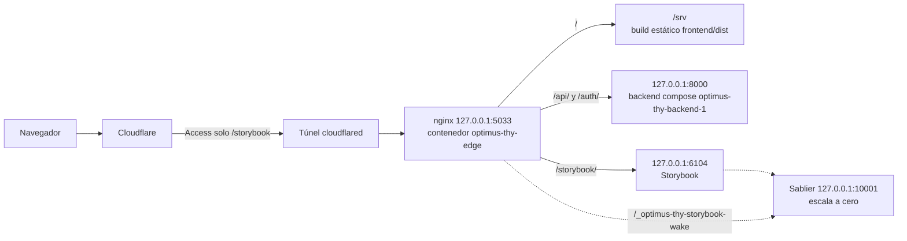

# Despliegue en tiroides2.andresgaibor.com

> **Alcance exclusivo:** este runbook aplica solo a `tiroides2`, con Cloudflare Tunnel y nginx en `127.0.0.1:5033`. Para `labturingserver` (Docker Compose, HTTPS 18443 por Tailscale), usa [labturingserver.md](labturingserver.md). No mezclar procedimientos, rutas, servicios ni volúmenes entre ambos entornos.

> Referencia: [labturingserver.md](labturingserver.md) documenta el servidor nuevo; sus procedimientos no aplican a tiroides2.

## Topología



Notas de borde:

- `cloudflared.service` usa token y enruta hacia el contenedor `optimus-thy-edge` con `--network host`.
- nginx dentro de `optimus-thy-edge` escucha en `127.0.0.1:5033`.
- Montajes del contenedor: `~/.config/optimus-thy/nginx.conf` → `/etc/nginx/nginx.conf` (ro) y `/home/ubuntu/code/optimus-thy-operativo/frontend/dist` → `/srv` (ro).
- `root /srv`; `location /` usa `try_files $uri $uri/ /index.html`.
- `location /api/` y `/auth/` usan `proxy_pass http://127.0.0.1:8000/`.
- `/storybook/` proxyea a `127.0.0.1:6104`; `/_optimus-thy-storybook-wake` proxyea a Sablier en `127.0.0.1:10001`.

## Estado esperado

| Ruta | Respuesta esperada | Comando de comprobación |
|---|---|---|
| `/` | `200` con el HTML del build estático | `curl -sS -o /dev/null -w '%{http_code}\n' https://tiroides2.andresgaibor.com/` |
| `/login` | `200` (la SPA resuelve con `/index.html`) | `curl -sS -o /dev/null -w '%{http_code}\n' https://tiroides2.andresgaibor.com/login` |
| `/assets/...` | `200` (o `304` si aplica caché) para un asset real del build | `ASSET=$(curl -sS https://tiroides2.andresgaibor.com/ \| grep -oE '/assets/[^"]+' \| head -n1); curl -sS -o /dev/null -w '%{http_code}\n' "https://tiroides2.andresgaibor.com${ASSET}"` |
| `/api/auth/me` | `401` si el backend está vivo y no hay sesión; `502` indica backend sin proceso | `curl -sS -o /dev/null -w '%{http_code}\n' https://tiroides2.andresgaibor.com/api/auth/me` |
| `/storybook/` | `200` con sesión válida de Cloudflare Access; sin cookie, redirección al login de Access | `curl -sS -o /dev/null -w '%{http_code}\n' https://tiroides2.andresgaibor.com/storybook/` |

## Acceso por Tailscale

Publica el edge en la tailnet (tailnet-only, sin pasar por Cloudflare Access):

```bash
tailscale serve --bg --https 443 http://127.0.0.1:5033
```

URLs resultantes:

- `https://<NOMBRE_TAILNET>/` (app)
- `https://<NOMBRE_TAILNET>/storybook/` (catálogo)

Handlers actuales en 443:

| Ruta | Destino | Nota |
|---|---|---|
| `/` | `127.0.0.1:5033` | este despliegue |
| `/__sablier/elcaliz` | `127.0.0.1:80` | preexistente, ajeno a este despliegue |

Se usa 443 porque el cliente Vite fija `STORYBOOK_HMR_PORT=443`; con otro puerto la página carga pero el HMR no conecta. Handshake esperado: `wss://<NOMBRE_TAILNET>:443/storybook/?token=…` → `101`.

Deshacer:

```bash
tailscale serve --https=443 off
```

## Desplegar el frontend

```bash
cd frontend
bun run build
```

- El resultado se genera en `frontend/dist` (build de Vite).
- Como `/srv` del contenedor `optimus-thy-edge` es un bind mount de `/home/ubuntu/code/optimus-thy-operativo/frontend/dist`, reconstruir publica al instante sin reiniciar nginx.
- Verificación posterior:

```bash
curl -sS -o /dev/null -w '%{http_code}\n' https://tiroides2.andresgaibor.com/
curl -sS -o /dev/null -w '%{http_code}\n' https://tiroides2.andresgaibor.com/login
```

## Recrear el contenedor edge

Usar el montaje real del repo y la configuración de nginx del host:

```bash
docker run -d --name optimus-thy-edge --restart unless-stopped --network host \
  -v ~/.config/optimus-thy/nginx.conf:/etc/nginx/nginx.conf:ro \
  -v /home/ubuntu/code/optimus-thy-operativo/frontend/dist:/srv:ro \
  nginx:alpine
```

Advertencia: al recrear, el contenedor viejo puede seguir ocupando `127.0.0.1:5033` y el nuevo fallar con `bind() to 127.0.0.1:5033 failed (98: Address in use)`. Procedimiento seguro:

```bash
docker rename optimus-thy-edge optimus-thy-edge-old
docker stop optimus-thy-edge-old
docker run -d --name optimus-thy-edge --restart unless-stopped --network host \
  -v ~/.config/optimus-thy/nginx.conf:/etc/nginx/nginx.conf:ro \
  -v /home/ubuntu/code/optimus-thy-operativo/frontend/dist:/srv:ro \
  nginx:alpine
# verificar antes de borrar
curl -sS -o /dev/null -w '%{http_code}\n' https://tiroides2.andresgaibor.com/
docker rm optimus-thy-edge-old
```

No editar el nginx del contenedor en caliente; la fuente es `~/.config/optimus-thy/nginx.conf`.

## Backend

- Forma principal en este corte: la API corre como contenedor Compose `optimus-thy-backend-1` (servicio `backend` de `docker-compose.yml`), publicada en `127.0.0.1:8000` para que el edge en `--network host` la alcance. PostgreSQL y MinIO permanecen en la red `optimus-thy-net`.
- Alternativa: unit de usuario `infra/systemd/optimus-thy-backend.service` (uvicorn en `127.0.0.1:8000`, paths del repo operativo). No debe competir con el contenedor Compose por el mismo puerto.
- MinIO está fijado por digest (ADR-014) en `docker-compose.yml`; una actualización exige cambiar el digest y verificar backup/restauración.
- El backend recibe `ALLOWED_ORIGINS` y `SESSION_COOKIE_SECURE` desde `.env`/compose. `.env` de producción debe llevar `ENVIRONMENT=production`, `SESSION_COOKIE_SECURE=true` y `ALLOWED_ORIGINS=https://tiroides2.andresgaibor.com`.
- Diagnóstico del 502 observado al preparar el corte: `GET /api/auth/me` respondía `502` porque **nada escuchaba en `127.0.0.1:8000`** (el backend no estaba publicado hacia el host). Comprobación directa:

```bash
curl -sS -o /dev/null -w '%{http_code}\n' http://127.0.0.1:8000/health
```

Si responde `200`, el backend está vivo; si falla la conexión o nginx sigue devolviendo `502`, revisar estado/logs del servicio activo (`docker compose ps backend` y `docker compose logs backend`, o el unit systemd si se usa la alternativa) antes de asumir fallo de nginx.
- Base: contenedor `optimus-thy-postgres-1`, usuario `optimus`, base `optimus`. La revisión de migración efectiva debe comprobarse en el host; no se afirma una revisión concreta ni se presume que haya un upgrade pendiente. El flujo nuevo de migraciones explícitas corresponde al procedimiento de labturingserver en [labturingserver.md](labturingserver.md), no a este runbook.
- `DATABASE_URL` debe usar el nombre de servicio `postgres:5432` (DNS interno del compose); no usar IPs de contenedor.


## Corte al repo operativo

Este runbook describe la operación/corte del entorno tiroides2; **no ejecuta el corte real** (no reinstala, no reconstruye, no recrea contenedores). Las referencias a repo, mounts, Compose y sistema son específicas de esta instalación antigua. Para desplegar en labturingserver, no usar estos pasos.

1. **Preparar entorno:** confirmar que `.env` existe con valores de tiroides2 y, como mínimo, `ENVIRONMENT=production`, `SESSION_COOKIE_SECURE=true` y `ALLOWED_ORIGINS` correspondiente a ese entorno. Verificar que MinIO sigue fijado por digest en `docker-compose.yml`.
2. **Frontend:** desde `frontend/`, instalar dependencias si hace falta y ejecutar `bun run build`. El resultado queda en `frontend/dist`.
3. **Servicios de datos/API:** `docker compose up -d backend storage` (y `postgres` si corresponde al estado del stack). Confirmar que el backend publica `127.0.0.1:8000`.
4. **Verificar backend antes del edge:** `curl -sS -o /dev/null -w '%{http_code}\n' http://127.0.0.1:8000/health` debe responder `200`.
5. **Recrear el edge con el mount del repo operativo** (procedimiento seguro de rename, evita conflicto en `127.0.0.1:5033`): capturar mounts (`docker inspect optimus-thy-edge --format '{{json .Mounts}}'`), `docker rename optimus-thy-edge optimus-thy-edge-old && docker stop optimus-thy-edge-old`, crear el nuevo edge montando `/home/ubuntu/code/optimus-thy-operativo/frontend/dist:/srv:ro` y `~/.config/optimus-thy/nginx.conf:/etc/nginx/nginx.conf:ro`, verificar, y solo entonces `docker rm optimus-thy-edge-old`.
6. **Verificar corte completo:**
   - `/` → `200`
   - `/login` → `200`
   - un asset real bajo `/assets/...` → `200` o `304`
   - `/api/auth/me` → `401` (backend vivo, sin sesión), **no** `502`
   - `/storybook/` → `200` con sesión válida de Cloudflare Access (sin cookie, redirección a Access)

## Storybook y HMR

- `optimus-thy-storybook.service` (systemd de usuario) lanza `storybook dev` en `0.0.0.0:6104`.
- Variables de entorno relevantes: `STORYBOOK_BASE=/storybook/`, `STORYBOOK_HMR_PORT=443`, `STORYBOOK_HMR_PROTOCOL=wss`.
- La unidad que lo arranca está en el repo: `infra/dev/optimus-thy-storybook.service` (enlazada en `~/.config/systemd/user/`); el base path y el HMR se configuran en `frontend/.storybook/main.ts` (`viteFinal`).
- Tras cambiar `main.ts` o las variables del unit: `systemctl --user restart optimus-thy-storybook` y esperar a que `curl -fsS http://127.0.0.1:6104/` responda 200.
- `STORYBOOK_HMR_PROTOCOL=wss` y puerto `443` son necesarios porque el navegador accede por HTTPS a través de Cloudflare; el handshake HMR debe usar WebSocket seguro en el puerto público.
- Sablier escala Storybook a cero; nginx expone `/_optimus-thy-storybook-wake` hacia Sablier en `127.0.0.1:10001` para el despertar.
- Cloudflare Access protege `/storybook/`: sin cookie el handshake devuelve 302 al login de Access; con sesión válida el WebSocket debe responder `101`.
- Rutas de assets del catálogo: `staticDirs` sirve en `images/`. En el catálogo desplegado la ruta válida es `/storybook/images/...`; `/images/...` en la raíz devuelve 500. En stories/MDX usar `import.meta.env.BASE_URL` o rutas relativas, nunca `/images/...`.

## Síntomas y causa

| Síntoma | Causa probable | Comprobación |
|---|---|---|
| `403` en `/` | `/srv` montado a un directorio vacío o inexistente (p. ej. `frontend/dist` vacío o bind mount apuntando al repo equivocado) | `docker inspect optimus-thy-edge --format '{{json .Mounts}}'`; verificar que el origen del bind mount de `/srv` contiene `index.html` |
| `500` en `/images/*` (raíz) | Rutas absolutas `/images/...` en stories/MDX; la ruta válida bajo el despliegue es `/storybook/images/...` | Revisar referencias a `/images/` en stories/MDX y confirmar que usan `import.meta.env.BASE_URL` o rutas relativas |
| `502` en `/api/*` | Backend sin proceso/publicación en `127.0.0.1:8000` o nginx sin upstream alcanzable | `curl -sS -o /dev/null -w '%{http_code}\n' http://127.0.0.1:8000/health` y estado de `optimus-thy-backend-1` / `optimus-thy-backend.service` |
| `500` en `/login` | La SPA no se sirve correctamente (build ausente, `try_files` sin `index.html`) o error del frontend servido desde `/srv` | Comprobar `/` y existencia de `index.html` en el origen montado como `/srv` |
| WebSocket sin `101` en Storybook HMR | Storybook apagado/escalado a cero, variables HMR incorrectas, o falta sesión de Cloudflare Access (devuelve 302) | Probar acceso autenticado a `/storybook/`; revisar `STORYBOOK_HMR_PORT=443` y `STORYBOOK_HMR_PROTOCOL=wss` en el servicio |
| `bind() to 127.0.0.1:5033 failed (98: Address in use)` al recrear el edge | El contenedor viejo (`optimus-thy-edge` u otro proceso) sigue ocupando `127.0.0.1:5033` | `docker ps --format '{{.Names}} {{.Ports}}'` y `docker logs optimus-thy-edge`/logs del contenedor nuevo; parar el viejo antes de arrancar el nuevo |
| `502` puntual justo tras reiniciar Storybook | Storybook aún no está listo o Sablier está despertando la instancia | Reintentar tras unos segundos y comprobar estado de `optimus-thy-storybook.service` y del wake en `/_optimus-thy-storybook-wake` |
| `«Oh no! Something went wrong loading this Storybook»` (o `GET /index.json` → 500) | Sintaxis rota en algún `.stories.tsx` o `.mdx`; Vite no puede indexar el catálogo | `curl -s http://127.0.0.1:6104/index.json \| head -c 400` muestra la lista de archivos con error bajo `Unable to index files` |

## Checklist antes de decir que está listo

1. `curl -sS -o /dev/null -w '%{http_code}\n' https://tiroides2.andresgaibor.com/` devuelve `200`.
2. `curl -sS -o /dev/null -w '%{http_code}\n' https://tiroides2.andresgaibor.com/login` devuelve `200`.
3. Un asset real bajo `/assets/...` responde `200` o `304`.
4. `curl -sS -o /dev/null -w '%{http_code}\n' https://tiroides2.andresgaibor.com/api/auth/me` devuelve `401` (backend vivo) y no `502`.
5. `https://tiroides2.andresgaibor.com/storybook/` carga con sesión de Cloudflare Access y el WebSocket HMR completa el handshake `101`.
6. Las imágenes del catálogo cargan desde `/storybook/images/...` (no desde `/images/...` en la raíz).
7. `curl -s -o /dev/null -w '%{http_code}\n' http://127.0.0.1:6104/index.json` devuelve `200`.

## Qué no hacer

- No editar el nginx del contenedor `optimus-thy-edge` en caliente; modificar `~/.config/optimus-thy/nginx.conf` y recrear el contenedor si hace falta.
- No montar `/srv` desde otro repo; el origen correcto del frontend es `/home/ubuntu/code/optimus-thy-operativo/frontend/dist`.
- No borrar `optimus-thy-edge` sin capturar antes sus montajes (`docker inspect optimus-thy-edge --format '{{json .Mounts}}'`): es la única copia de su configuración, porque el contenedor se creó a mano, no con Compose.
- No ejecutar `docker compose down -v` sobre el stack antiguo: borra los volúmenes de PostgreSQL y MinIO.
- No usar `bitnamilegacy/minio:latest`; mantener MinIO fijado por digest (ADR-014).
- No ejecutar el corte sin verificar `http://127.0.0.1:8000/health` primero; un `502` en `/api/*` suele indicar backend no publicado/no vivo.