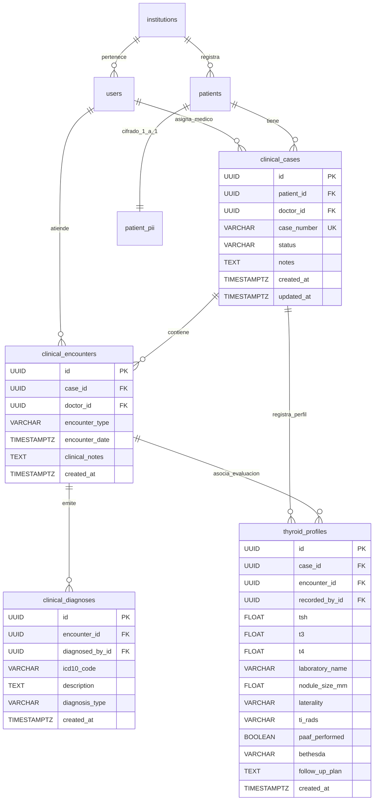

# Comparativa Arquitectural: Esquema Canónico Alembic vs DDL Legacy (`backend/sql/DDL.sql`)

**Issue:** [TES-97](https://linear.app/andres-gaibor/issue/TES-97)  
**Proyecto:** OPY — referencia funcional  
**Fecha:** 2026-09-22  

---

## Resumen Ejecutivo

El archivo `backend/sql/DDL.sql` contenía una propuesta de diseño relacional inicial que requería ejecución manual, acoplaba funciones criptográficas a PostgreSQL con claves quemadas en código y presentaba patrones no alineados con los ADR del repositorio principal. 

A través de **TES-97**, la fuente de verdad del esquema de base de datos ha sido formalizada mediante **SQLAlchemy 2 Async** y migraciones versionadas con **Alembic**, eliminando la intervención manual en despliegues y garantizando reproducibilidad completa.

---

## Matriz de Diferencias Principales

| Dimensión | Enfoque Legacy (`backend/sql/DDL.sql`) | Enfoque Canónico ([TES-97](https://linear.app/andres-gaibor/issue/TES-97)) | Justificación Técnica |
|---|---|---|---|
| **Gestión de Esquema** | Scripts DDL manuales en PostgreSQL sin versionamiento ni control de rollback | Modelos SQLAlchemy 2 Declarative + Alembic Async con `upgrade head` y `downgrade base` verificados en CI | Evita drift entre entornos, permite despliegues automáticos y rollbacks reproducibles |
| **Claves Primarias** | Secuencias `serial` / `integer` autoincrementales | UUID v4 (`uuid.UUID` / `pg_catalog.uuid`) en todas las entidades principales | Previene enumeración de recursos (IDOR), facilita sharding y anonimización de investigación |
| **Protección de PII** | Procedimientos almacenados con `pgcrypto` y clave fija `'clave_dev_v1'` embebida | Cifrado en capa de aplicación con **AES-256-GCM** y clave inyectada por entorno (`PII_ENCRYPTION_KEY`) | Los secretos nunca se guardan en el motor de base de datos ni en el repositorio; la base de datos almacena exclusivamente texto cifrado en reposo |
| **Separación de Paciente y PII** | Tablas con mezcla de datos operacionales y datos personales | Entidad operacional `patients` separada de `patient_pii` (1:1 cascade) | Permite referenciar y analizar pacientes en cohortes sin exponer datos de filiación |
| **Modelo RBAC** | Tablas N:M (`roles`, `roles_usuario`, `permisos`) con permisos ficticios | Un único rol canónico por usuario (`role: admin \| doctor \| researcher`) según ADR vigente | Elimina sobre-ingeniería no alineada al dominio clínico y simplifica guards de autorización |
| **Sesiones y Tokens** | Sin soporte de sesiones opacas en DB | Tabla `sessions` con `token_hash` (SHA-256), expiración y auditoría de User-Agent/IP | Permite revocación centralizada de sesiones y protección contra replay attacks |
| **Auditoría** | Múltiples tablas fragmentadas (`log_eventos`, `log_seguridad`, etc.) | Tabla consolidada e inmutable `audit_events` (append-only) | Trazabilidad completa y unificada para los paneles administrativos y auditorías médicas |
| **Población Inicial** | `SEED.sql` monolítico no idempotente | Script `seed.py` asíncrono e idempotente con datos 100% ficticios | Permite reejecutar la inicialización múltiples veces sin duplicidad ni violaciones de unicidad |

| **Modelo Clínico** | Esquema conceptual aislado | Entidades canónicas `clinical_cases`, `clinical_encounters`, `thyroid_profiles`, `clinical_diagnoses` validadas con la UI del médico/investigador ([TES-105](https://linear.app/andres-gaibor/issue/TES-105)) | Satisface requerimientos de perfil tiroideo (TSH, T3, T4), nódulo (tamaño, lateralidad, TI-RADS), biopsia (PAAF, Bethesda) y diagnósticos CIE-10 |

---

## Diagrama Entidad-Relación Clínico Canónico

---

## Verificación de Calidad

1. **Rollback de Migraciones:** Verificado mediante tests que ejecutan `downgrade base` y `upgrade head`.
2. **Restricciones de Integridad:** Verificadas mediante tests de clave foránea, unicidad (`Institution.code`, `User.email`, `ClinicalCase.case_number`) y borrado en cascada.
3. **Cifrado en Reposo:** Verificado mediante lectura directa de la base de datos confirmando ausencia de texto plano y descifrado correcto con la clave del entorno.
4. **Idempotencia de Seed:** Verificado mediante ejecución duplicada comprobando que el recuento de registros permanece inalterado.
5. **Integridad Relacional Clínica:** Verificado mediante suite `backend/tests/test_clinical_models.py` probando ciclo de vida caso -> encuentro -> diagnóstico -> perfil tiroideo.
